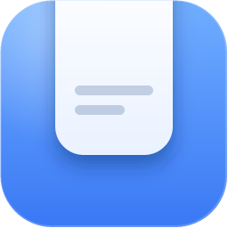

<p align="center">
  
</p>

<h1 align="center">檐下 · Eave</h1>

<p align="center"><strong>从屏幕顶边滑出的毛玻璃搁板，收住你复制的一切。</strong></p>

<p align="center">
  <a href="https://github.com/LOUIS798000/Eave/releases/latest"></a>
  &nbsp;
  <a href="LICENSE"></a>
  &nbsp;
  
</p>

---

## 它是什么

「檐下」常驻在屏幕顶边，平时只是一条几乎看不见的窄檐。鼠标靠过去，它滑下来展开成一块毛玻璃搁板，里面是你刚复制的文字、链接、颜色、截图和文件。把任意一张卡片**拖出去**，直接落进桌面、资源管理器或任何编辑器——不切窗口，不按快捷键。

## 功能

- **悬停即开** — 碰到顶边就展开，移开自动收起；也可用热键（默认 `Alt+C`）手动开合。
- **收全部类型** — 纯文本、富文本 / HTML、链接、颜色值、图片、多文件。
- **拖出即用** — 原生拖拽，拖到任何接受文件或文本的程序里。
- **文件自动成摞** — 多次复制的文件合并成 `×3` 文件堆，可整体拖出，也能拆开单拖。
- **实时毛玻璃** — `Windows.UI.Composition` 亚克力，背后真实桌面透出来，并逐帧跟随展开形状。
- **搜索与筛选** — 搜索框 + 类型标签：全部 / 文本 / 链接 / 图片 / 文件 / 颜色。
- **纯本地** — 无账号、无网络请求、无遥测；卸载即清空。
- **可调** — 贴边位置、面板尺寸、触发宽度与延迟、毛玻璃强度、字号、界面语言（30+）、开机自启、全屏时隐藏。

## 我做的改进

本仓库基于开源项目 [Edge-Drop](https://github.com/Deepender25/Edge-Drop)，以下是我在其之上重写与优化的部分：

- **内存 168 MB → 86 MB** — 去掉启动时预渲染并常驻的 15 张拖拽图标，SVG 光栅化器改为首次拖拽才加载，图标缓存 64 → 24，网络服务并入主进程（进程数 4 → 3）。毛玻璃、即时响应与历史容量均未削减。
- **真正跟随动画的实时毛玻璃** — 按当前形状逐帧绘制，而不是"展开结束后补一张模糊底图"。
- **中文优先** — 产品名「檐下」为主，`Eave` 仅作英文辅助名；中英文案与 31 种语言全部重写。
- **全新蓝白图标** — 手写多尺寸 ICO（16–256 共 9 档），蓝底白搁板，与名字和功能一致。
- **设置界面重做** — 统一卡片网格、光学居中的分段控件、去掉多余开关。
- **移除应用内更新器与上游脚手架** — 不再检查更新，不再有官网 / 商店跳转。
- **修复** — 热键取消时的模糊残影、边缘悬停丢失、全屏切换后毛玻璃消失、堆叠布局退出按钮错位。

## 下载

[Releases](https://github.com/LOUIS798000/Eave/releases/latest) 里的 `Eave-Setup-x.y.z.exe`，Windows 10 / 11 x64。装进用户目录，不需要管理员权限。安装包未做代码签名，首次运行若被 SmartScreen 拦下，点「更多信息 → 仍要运行」。

## 构建

```bash
npm install
npm run dev        # 开发
npm run build:win  # 打包 Windows 安装包
npm test           # 单元测试
```

## 致谢与许可

- 原始项目：[Edge-Drop](https://github.com/Deepender25/Edge-Drop)，作者 [@Deepender25](https://github.com/Deepender25)，Apache-2.0。
- 表情图案：[Twemoji](https://github.com/twitter/twemoji)，CC-BY 4.0。
- 本项目以 [Apache-2.0](LICENSE) 开源。

<details>
<summary>English</summary>

**檐下 (Eave)** — a hover-activated clipboard shelf for Windows. It sits invisibly on the top edge of the screen and slides down as a frosted-glass panel holding everything you copied: text, links, colors, screenshots and files. Drag any card straight out into any app — no window switching, no shortcuts.

A memory-trimmed fork of Edge-Drop: **168 MB → 86 MB** of RAM, live `Windows.UI.Composition` acrylic that follows the open animation, local-only storage, 30+ interface languages, hand-built multi-size ICO.

</details>
