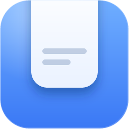

<p align="center">
  
</p>

<h1 align="center">檐下 · Eave</h1>

<p align="center"><strong>从屏幕顶边滑出的毛玻璃搁板，收住你复制的一切。</strong></p>

<p align="center">
  <a href="https://github.com/LOUIS798000/Eave/releases/latest"></a>
  &nbsp;
  <a href="LICENSE"></a>
  &nbsp;
  
</p>

---

## 它是什么

「檐下」常驻在屏幕顶边，平时只是一条几乎看不见的窄檐。鼠标靠过去，它滑下来展开成一块毛玻璃搁板，里面是你刚复制的文字、链接、颜色、截图和文件。把任意一张卡片**拖出去**，直接落进桌面、资源管理器或任何编辑器——不切窗口，不按快捷键。

## 功能

- **悬停即开 & 键盘全流程** — 碰到边缘就展开，移开自动收起；热键（默认 `Alt+C`）唤出后可直接用方向键选卡、`Enter` 粘贴、`Shift+Enter` 纯文本粘贴、`Alt+1~9` 直出前 9 条、`Ctrl+F` 或 `/` 搜索、`Del` 删除、`P` 置顶。
- **连续粘贴队列（`Alt+V`）** — 选中按 `Q` 或 `Alt+点击` 按顺序加入队列，切到目标软件连续按 `Alt+V` 依次弹出粘贴，队列为空时自动注销热键不占快捷键。
- **收全部类型** — 纯文本、富文本 / HTML、链接、颜色值、图片、多文件。
- **拖出即用** — 原生拖拽，拖到任何接受文件或文本的程序里。
- **文件自动成摞** — 多次复制的文件合并成 `×3` 文件堆，可整体拖出，也能拆开单拖。
- **智能文本清洗 & 就地编辑** — 预览浮层支持就地修改文本，并根据内容离线提供去 PDF 断行、JSON 美化/压缩、净化链接追踪参数、行去重、大小写切换。
- **实时毛玻璃 & 深浅色主题** — `Windows.UI.Composition` 亚克力逐帧跟随展开形状，支持浅色 / 深色 / 跟随 Windows 系统主题。
- **全文搜索与筛选** — 支持超过 300 字的长文本全文搜索、图片文件名与路径检索，以及全部 / 文本 / 链接 / 图片 / 文件 / 颜色筛选。
- **纯本地与隐私保护** — 无账号、无网络请求、无遥测；自动尊重密码管理器排除标志，并支持自定义「忽略应用」黑名单（如 `KeePass.exe`）。
- **可调** — 贴边位置、面板尺寸、触发宽度与延迟、毛玻璃强度、字号、置顶区默认展开、界面语言（31 种）、开机自启、全屏时隐藏。

## 我做的改进

本仓库基于开源项目 [Edge-Drop](https://github.com/Deepender25/Edge-Drop)，以下是我在其之上重写与优化的部分：

- **极致内存与包体瘦身** — 去掉启动时预渲染的 15 张拖拽图标，SVG 光栅化改为首次拖拽加载，网络服务并入主进程（进程数 4 → 3）；使用 Win32 原生 `SendInput` 与 `CF_HDROP` 替代常驻 `powershell.exe` 子进程（省去 30–60 MB 隐性后台内存）；剥离未使用的 `gsap` 依赖，31 种语言按需懒加载 + 主进程独立轻量词表（主进程包 `859 KB → 328 KB`，渲染主包 `1,779 KB → 1,266 KB`）。
- **真正跟随动画的实时毛玻璃与深色模式** — 按当前形状逐帧绘制，并完整适配浅色 / 深色 Liquid Glass 视觉体系。
- **数据可靠性与安全加固** — `items.json` / `settings.json` 原子写盘与 `.bak` 自动恢复，修复长文本去重索引与过期孤儿文件清理，启动自动对账回收孤儿资源；`edgelocal://file/` 增加历史路径白名单校验。
- **键盘流、连贴队列与离线文本工具台** — 补齐完整键盘导航、纯文本粘贴、全文搜索、`Alt+V` 顺序连贴队列、预览浮层就地编辑及智能文本清洗变换。
- **中文优先与全新蓝白图标** — 产品名「檐下」为主，`Eave` 仅作英文辅助名；手写多尺寸 ICO（16–256 共 9 档）；设置界面重做并移除应用内更新器与上游脚手架。
- **修复** — 热键取消时的模糊残影、边缘悬停丢失、全屏切换后毛玻璃消失、堆叠布局退出按钮错位、250 条历史下的全量卡片重渲染与主线程同步 `statSync` 阻塞。

## 下载

[Releases](https://github.com/LOUIS798000/Eave/releases/latest) 里的 `Eave-Setup-x.y.z.exe`，Windows 10 / 11 x64。装进用户目录，不需要管理员权限。安装包未做代码签名，首次运行若被 SmartScreen 拦下，点「更多信息 → 仍要运行」。

## 构建

```bash
npm install
npm run dev        # 开发
npm run build:win  # 打包 Windows 安装包
npm test           # 单元测试
```

## 致谢与许可

- 原始项目：[Edge-Drop](https://github.com/Deepender25/Edge-Drop)，作者 [@Deepender25](https://github.com/Deepender25)，Apache-2.0。
- 表情图案：[Twemoji](https://github.com/twitter/twemoji)，CC-BY 4.0。
- 本项目以 [Apache-2.0](LICENSE) 开源。

<details>
<summary>English</summary>

**檐下 (Eave)** — a hover-activated clipboard shelf for Windows. It sits invisibly on the top edge of the screen and slides down as a frosted-glass panel holding everything you copied: text, links, colors, screenshots and files. Drag any card straight out into any app — no window switching, no shortcuts.

A memory-trimmed fork of Edge-Drop: **168 MB → 86 MB** of RAM, live `Windows.UI.Composition` acrylic that follows the open animation, local-only storage, 30+ interface languages, hand-built multi-size ICO.

</details>
